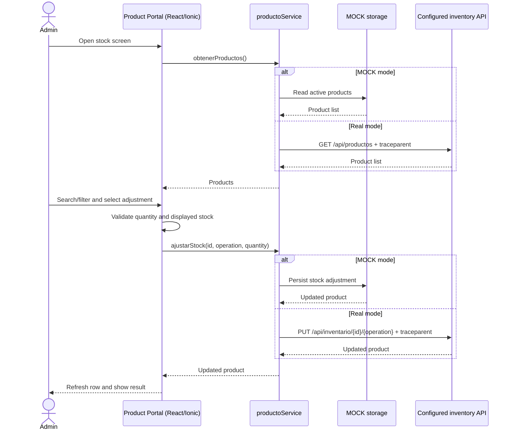

# CP1 - Product Portal stock-management journey

## Scope and evidence

This workshop follows the implemented Product Portal in `bysellens-product-portal`. Its README identifies it as a React/Ionic web application for consulting and controlling stock. The current implementation supports MOCK data and a configured HTTP mode; the repository does not contain the backend service or prove a deployed end-to-end connection.

The journey is therefore scoped to the Product Portal user experience and its product-service client:

> An administrator opens the stock page, loads active products, searches or filters the list, and increases or decreases stock.

## User journey

| Step | Component | Behavior | Evidence |
|---|---|---|---|
| 1 | Product Portal shell | Starts the shared login/session flow and opens the Products screen | `src/main.tsx` |
| 2 | Products screen | Loads active products and displays stock totals and status | `src/pages/Productos.tsx` |
| 3 | Products screen | Filters by product name/code and stock status in the browser | `src/pages/Productos.tsx` |
| 4 | Products screen | Validates a positive integer and prevents a decrement above displayed stock | `src/pages/Productos.tsx` |
| 5 | `productoService` | Reads MOCK data or calls `GET /api/productos` | `src/services/productoService.ts` |
| 6 | `productoService` | Updates MOCK data or calls `PUT /api/inventario/{id}/{operacion}?cantidad=n` | `src/services/productoService.ts` |
| 7 | Products screen | Replaces the updated row and displays success/failure feedback | `src/pages/Productos.tsx` |

## Sequence

## Trace design

The portal creates one W3C `traceparent` for each product-list load or stock adjustment. In real mode, it attaches that header to the HTTP request. The trace ID identifies the operation; a new span ID is generated for each operation. MOCK mode records the same client-side operation but has no network hop.

The portal code alone cannot prove that a backend accepts the header, preserves the trace, or emits correlated logs. CORS configuration, backend propagation, and deployed telemetry remain to be verified.

## Important boundary

The Product Portal repository is the frontend client for the product module. The separate Product Service documentation describes a backend design whose implementation/runtime verification is pending. The portal's current configured endpoint paths also need compatibility validation against the Product Service draft contract before claiming a working end-to-end integration.
