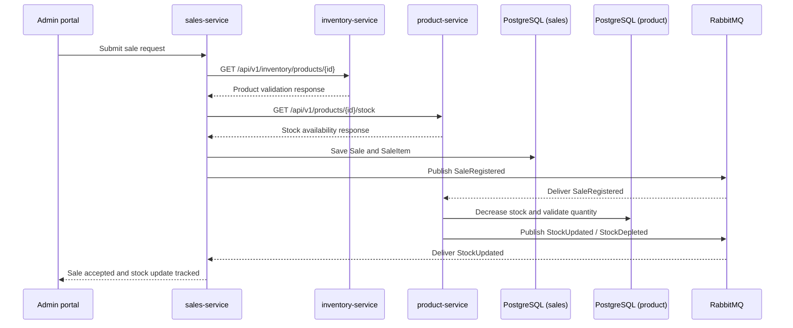

# Critical Journey and Trace Map

## Journey name

Register a sale and update stock after the sale.

## Business purpose

The business purpose of this journey is to allow the administrator to register a valid sale while preserving stock integrity. The flow must validate the customer and the selected products, persist the sale, and then update product availability after the sale is successfully registered.

This is one of the real project journeys explicitly defined in the architecture documentation and user stories:

- `01-context/scope.md` describes Product Management and Stock Update After a Sale.
- `04-requirements/user-stories.md` defines `HU-SALE-001` and `HU-SALE-003`.
- `09-microservices/communication-patterns.md` explains the synchronous validation and asynchronous stock update flow.
- `02-domain/domain-events.md` defines the domain events used in the path.
- `08-uml/diagrams/source/seq-register-sale.puml` documents the sequence of the sale and stock update.

## Evidence from the actual architecture

The project documentation defines the following real actors and components:

- `product-service` owns stock and availability.
- `inventory-service` owns product identity, code, category, prices, and initial stock.
- `sales-service` owns sales and sale items.
- RabbitMQ transports the domain events.
- PostgreSQL is the persistence technology for each service-owned database.

The documented asynchronous path is:

1. `sales-service` persists a sale and publishes `SaleRegistered`.
2. `product-service` consumes `SaleRegistered` and decreases stock.
3. `product-service` publishes `StockUpdated` and `StockDepleted`.
4. `sales-service` consumes `StockUpdated` and tracks that the stock update was processed.

This evidence is stronger than a generic example because it comes directly from the project documentation and the sequence diagram stored in the team repo.

## Hop table

| Caller | Callee | Protocol | Operation / endpoint | Sync or async | Relevant data |
|---|---|---|---|---|---|
| Admin portal / UI | `sales-service` | HTTP | Submit sale registration request | Synchronous | `customerId`, selected `items`, `paymentMethod`, total |
| `sales-service` | `inventory-service` | HTTP | `GET /api/v1/inventory/products/{id}` | Synchronous | product metadata and validation |
| `sales-service` | `product-service` | HTTP | `GET /api/v1/products/{id}/stock` | Synchronous | current quantity and stock availability |
| `sales-service` | PostgreSQL (`sales_db`) | SQL | Save `Sale` and `SaleItem` in one local transaction | Synchronous | `saleId`, `customerId`, item quantities, totals |
| `sales-service` | RabbitMQ | AMQP | Publish `SaleRegistered` | Asynchronous | `eventId`, `aggregateId`, `payload`, `metadata.correlationId` |
| `product-service` | RabbitMQ | AMQP | Consume `SaleRegistered` | Asynchronous | `eventId`, `aggregateId`, `causationId` |
| `product-service` | PostgreSQL (`product_db`) | SQL | Decrease stock and validate non-negative quantity | Synchronous | `productId`, `previousQuantity`, `newQuantity` |
| `product-service` | RabbitMQ | AMQP | Publish `StockUpdated` and `StockDepleted` | Asynchronous | `productId`, `previousQuantity`, `newQuantity`, `reason` |
| `sales-service` | RabbitMQ | AMQP | Consume `StockUpdated` | Asynchronous | `productId`, `newQuantity`, `correlationId` |

Important note: the sequence diagram and communication catalog define the operation names and expected messaging, but they do not prove that production trace headers already exist in runtime code. The project clearly defines the business flow; the observability propagation needs to be modeled and instrumented intentionally.

## Mermaid sequence diagram



## Trace-context propagation

The project design defines a distributed flow, but the documented architecture does not prove existing application-level trace propagation in the runtime code.

### HTTP propagation

For a real HTTP call, the expected propagation format is W3C `traceparent`:

```text
traceparent: 00-4bf92f3577b34da6a3ce929d0e0e4736-00f067aa0ba902b7-01
```

This pattern is the standard way to carry the same trace over the HTTP boundary between the admin portal, `sales-service`, `inventory-service`, and `product-service`.

### Message propagation

For RabbitMQ, the project event envelope already includes:

- `metadata.correlationId`
- `metadata.causationId`
- `eventId`

The design also defines a broker topic flow, but does not prove that broker headers such as `traceparent`, `tracestate`, or a message-copy of the HTTP trace context are already being set and consumed at runtime. The correct observability design is therefore to propagate both the business correlation metadata and the W3C trace context across the broker boundary.

### What should be instrumented

The missing or proposed instrumentation for this journey is:

- HTTP request middleware or filter to create the root span and write `traceparent`.
- Downstream HTTP propagation to `inventory-service` and `product-service`.
- AMQP message headers with `traceparent` and `tracestate` when publishing `SaleRegistered` and `StockUpdated`.
- Consumer-side extraction of trace context when reading from RabbitMQ.
- Structured logs that include `trace_id`, `span_id`, `correlation_id`, and `event`.

## Span tree

```text
root: sale.registration
├── sales.validate_customer
├── inventory.lookup_product
├── product.lookup_stock
├── sales.persist_sale
├── sales.publish_sale_registered
├── product.consume_sale_registered
├── product.decrement_stock
├── product.publish_stock_updated
├── sales.consume_stock_updated
└── sales.response
```

## How the same trace_id connects the distributed request

The same distributed request is represented by one root trace ID across the full business flow. The trace begins when the administrator submits the sale. The first HTTP request creates the root span and the root `trace_id`. Each downstream HTTP request and RabbitMQ message must carry the same `trace_id` while creating new `span_id` values for each hop.

In other words:

- `trace_id` stays constant for the entire business transaction.
- `span_id` changes for each service or message consumer.
- `correlation_id` can be used to align distributed business events with the same business operation.
- `causation_id` explains which event caused the next action.

This is how the same real business operation can be correlated across multiple services, persistence layers, and async boundaries even when the code paths are distributed.

## Missing or proposed instrumentation

The project documentation supports the business journey, but the following observability pieces are not proven as deployed implementation:

1. A proven HTTP tracing middleware in the admin portal or backend services.
2. A proven `traceparent` propagation path across `sales-service`, `inventory-service`, and `product-service`.
3. A proven RabbitMQ header propagation strategy for `traceparent` and `tracestate`.
4. A proven structured logging schema with the required fields and consistent `trace_id` values.
5. A proven metric instrumentation path for request latency, business errors, and stock-update processing.

This journey is therefore appropriate for Week 11 observability work because it is real, traceable, and clearly bounded by the documented architecture, even though the runtime tracing implementation is still missing.
