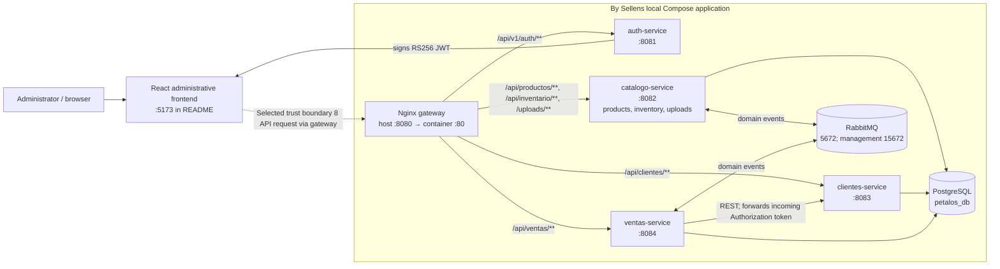

# CP1 — Attack Surface Map

## Scope and evidence status

The selected boundary is the React administrative frontend → product API
(documentation issue [#56](https://github.com/code-corhuila/bysellens-docs/issues/56)).
The available implementation evidence is a local, non-Git snapshot of
`bysellens-microservicios`; it implements product and inventory routes in
`catalogo-service`, not a separately verified `product-service`. The separate
Product Portal clone is also a local snapshot and defaults to MOCK mode.
Therefore this is a code-based map of those snapshots, not proof of deployed
topology or the canonical production implementation.

## A. Architecture and trust boundaries

The issue's selected frontend-to-product-API boundary is represented by the
dashed client-to-gateway edge; Nginx routes that request to the implementation
currently named `catalogo-service`. The shared Spring
Security configuration requires JWT role `ADMIN` on all routes except explicit
public paths; the gateway forwards `Authorization` but does not itself enforce
authorization. Compose does not publish backend service ports in the inspected
file, but this does not prove that other deployment paths cannot reach them.
Gateway-to-service and service-to-data boundaries are internal trust boundaries.
The product-domain label here refers to the issue; the implementation evidence
is `catalogo-service`.

## B. Asset inventory

| Asset | Classification | Owner / location | Exposure, modification, or outage consequence |
|---|---|---|---|
| Administrator access token and signing keys | restricted | Auth; `keys/` mount and browser `sessionStorage` | Token theft permits ADMIN actions until expiry; private-key disclosure permits token forgery. |
| Product records, prices, stock and uploaded images | confidential | `catalogo-service`; `productos`, `data/uploads/` | Disclosure exposes business data; tampering affects pricing/availability; outage blocks product and stock work. |
| Customer contact details | confidential | `clientes-service`; `clientes` table | Disclosure exposes personal contact data; tampering or outage disrupts customer/sale workflows. |
| Sales, line items and payment-method labels | confidential | `ventas-service`; `ventas`, `detalle_ventas` | Disclosure exposes commercial history; tampering affects records and reconciliation. |
| PostgreSQL business records | restricted | PostgreSQL `petalos_db` and named tables | Unauthorized read/write affects every service sharing the database; outage interrupts persistence. |
| RabbitMQ events and queues | internal | RabbitMQ; catalog and sales listeners | Forged, replayed, or lost events can misstate sale/stock outcomes; outage stalls the sale saga. |
| Product images | public | `catalogo-service`; `/uploads/**` | Public reads are allowed by configuration; malicious or replaced content can mislead users or consume storage/bandwidth. |

Classification is an assessment for this exercise, not a classification label
found in the application.

## C. Entry points

Auth and business APIs use the shared resource-server filter in the inspected
snapshot. Protected routes require a valid JWT and `ADMIN`; expected missing or
invalid authentication is `401`, and insufficient role is `403`. These are
code-level expectations, not observed HTTP test results.

| Entry point / owner | Caller and authentication / authorization | Data and verified validation | Risks / unknowns |
|---|---|---|---|
| `POST /api/v1/auth/login` — Auth, through gateway | Browser; public, no token. | JSON email/password; `@Valid`, nonblank and email format; in-memory maximum 10 attempts per IP / 5 min, reset after successful login. | Client IP trusts first `X-Forwarded-For`; limiter has no shared state; `429` response/header behavior differs from documented contract and needs runtime verification. |
| `GET /api/productos`, `GET /api/productos/{id}` — catalog | Browser via gateway; JWT `ADMIN`. | Product data read; no request body. | Confidential prices/stock exposed if authorization is bypassed; direct-service access must be checked in deployed network. |
| `POST /api/productos`, `PUT /api/productos/{id}`, `DELETE /api/productos/{id}` — catalog | Browser via gateway; JWT `ADMIN`. | Multipart product JSON and optional image; DTO validates required text, lengths, positive prices and nonnegative stock. Multipart limit: 5 MB/file, 10 MB/request. | Image content/type validation and resource-level limits beyond multipart size are not verified; changes/deletion are high-impact. |
| `GET /api/inventario`, `GET /api/inventario/bajo-stock`, `GET /api/inventario/{id}`, `PUT /api/inventario/{id}/aumentar`, `PUT /api/inventario/{id}/disminuir` — catalog | Browser via gateway; JWT `ADMIN`. | Product/stock data; update amount is an integer query parameter. | Controller has no visible `@Min` on amount; domain safeguards and malformed/large request handling need tests. |
| `GET /api/clientes`, `GET /api/clientes/{id}`, `POST /api/clientes`, `PUT /api/clientes/{id}`, `DELETE /api/clientes/{id}` — Customers | Browser via gateway; JWT `ADMIN`. | Customer name, phone, optional email/address; DTO has nonblank/length/email validation. | Personal data disclosure/modification; retention and pagination are not verified. |
| `GET /api/ventas`, `GET /api/ventas/{id}`, `POST /api/ventas` — Sales | Browser via gateway; JWT `ADMIN`. | Customer ID, payment method and sale lines; DTO requires customer, payment method, nonempty lines, product IDs and quantity ≥1. | Sensitive history; DTO has no visible upper bound on line count or payment-method length. |
| `GET/HEAD /uploads/**` — catalog via gateway | Browser; resource handler is configured public, no JWT required. | Uploaded product image bytes. | Public access is intentional in this snapshot; content validation, cache policy and abuse limits need verification. |
| `GET /api/clientes`, `GET /api/clientes/{id}` — Customers, also called by Sales | Browser through gateway or `ventas-service`; JWT `ADMIN`, forwarded by Sales adapter and validated by Customers. | Customer contact data returned to Sales for a sale. | Token propagation and recipient trust are security-sensitive; REST call must remain on the configured trusted destination. |
| RabbitMQ event queues — catalog and sales listeners | Internal broker publishers; broker authentication/configuration present, per-message authorization/signature not verified. | Sale-created and stock-reserved/rejected integration events. | Spoofing/replay, schema validation and broker reachability need review; no browser JWT is used for consumers. |
| PostgreSQL `:5432`; RabbitMQ `:5672`, management `:15672`; gateway `:8080` — Compose interfaces | Local host/network clients; DB/broker credentials are configured in Compose; deployed access controls not verified. | SQL records, broker messages and management operations. | Compose uses development credentials (`postgres` / `guest` examples) and publishes infrastructure ports; do not treat as production-secure configuration. |

No separate product-service endpoint, production deployment, external identity
provider, or runnable authorization test was verified in the available
snapshots. No health route was found in the inspected controller set. The
separate Product Portal uses `/api/productos` and defaults to MOCK; its exact
authentication behavior is not verified here.

## Evidence inspected

- `bysellens-microservicios/docker-compose.yml`, `gateway/nginx.conf`,
  `README.md`.
- `frontend/src/AuthContext.tsx`, `frontend/src/services/api.ts`,
  `frontend/src/services/productoService.ts`.
- `shared-kernel/.../security/ResourceServerSecurityConfig.java`.
- Auth, catalog, customer and sales web controllers and request DTOs under
  their respective `src/main/java/.../infrastructure/adapter/in/web/` paths.
- `shared-kernel/.../messaging/` and service `.../adapter/in/messaging/`
  listeners.
- `ventas-service/.../adapter/out/rest/ClientesRestAdapter.java` and
  `catalogo-service/.../infrastructure/config/CatalogoConfig.java`.
- `.../src/main/resources/application.properties` for the four services.

All implementation files above are from local snapshots without Git metadata.
No runtime request, Docker deployment, or authorization test was executed for
this map.
